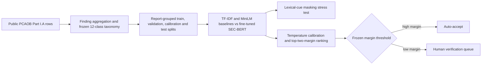

# Selective Audit Routing

Reproducibility package for **Calibrated Selective Classification of PCAOB
Inspection Findings with a Domain-Adapted Transformer**.

Public repository:
<https://github.com/HuiyingZHOU15/selective-audit-routing>. Cite a versioned
release rather than the moving `main` branch once the release is archived.

## Paper in one flow



The paper asks whether SEC-BERT improves retrospective classification, whether
that improvement survives removal of explicit audit-area cues, and whether a
calibrated abstention policy can increase agreement within the automatically
accepted subset. It does not claim autonomous audit reasoning, completed human-
machine workflow accuracy, or prospective temporal validity.

## Headline frozen results

- SEC-BERT retrospective test: accuracy 0.9337; macro-F1 0.9021.
- Masking explicit audit-area cues without retraining: macro-F1 0.2787.
- Matched masked-input SEC-BERT training: macro-F1 0.5332.
- High-coverage policy: coverage 0.9640; selective accuracy 0.9522.
- Conservative policy: coverage 0.9292; selective accuracy 0.9661; disagreement capture 0.5254.

## Repository map

- `manuscript/`: LaTeX manuscript and evidence ledger.
- `src/`: data construction, models, calibration, evaluation and plotting.
- `notebooks/kaggle_sec_bert_calibration_export_v1.ipynb`: canonical GPU training and checkpoint export.
- `results/tables/`: prediction-level and tabular analysis artifacts.
- `results/metrics/`: machine-readable metric summaries.
- `results/reports/`: experiment reports and canonical-result ledgers.
- `tests/`: deterministic data-construction checks.

Exploratory RAG and external-LLM scripts remain for provenance, but they are not
part of the manuscript's evidential main line and are not required for any paper
claim.

## Reproduction level 1: reported results without retraining

Use this path to audit the manuscript from released predictions, logits and
frozen operating points. It does not require a GPU.

1. Create a Python 3.13 environment and install the versions recorded in
   `results/masking_v2/metrics/environment.json`.
2. Verify the tables and metric JSON files against
   `manuscript/evidence_ledger_v1.csv` and
   `results/reports/sec_bert_canonical_v3_zh.md`.
3. Regenerate the canonical analysis export:

```powershell
python src/export_canonical_v3_manuscript_artifacts.py `
  --canonical-run PATH_TO_CANONICAL_RUN `
  --masking-run PATH_TO_MASKING_RUN `
  --output-root results/canonical_v3
```

4. Regenerate the manuscript figures:

```powershell
python src/plot_model_comparison_sensitivity_v1.py
python src/plot_probability_calibration_v1.py
python src/plot_selective_performance_v2.py
python src/plot_dataset_construction_distribution_v1.py
python src/plot_risk_score_comparison_v1.py
python src/plot_class_referral_allocation_v1.py `
  --scored results/canonical_v3/tables/sec_bert_canonical_v3_test_scored.csv `
  --metrics PATH_TO_CANONICAL_RUN/downstream/metrics.json `
  --version v3
python src/plot_class_context_error_analysis_v1.py `
  --context results/canonical_v3/tables/sec_bert_context_quality_test_v3.csv `
  --confusion results/canonical_v3/tables/sec_bert_confusion_pairs_test_v3.csv `
  --version v3
python src/plot_sec_bert_class_performance_v1.py `
  --scored results/canonical_v3/tables/sec_bert_canonical_v3_test_scored.csv `
  --version v3
python src/plot_ambiguity_signal_diagnostics_v1.py
```

A reproduction should stop and report an error if the headline values or
artifact hashes differ.

## Reproduction level 2: rebuild and retrain

### 1. Reacquire and verify the public source

Download the PCAOB Part I.A inspection-findings file from the PCAOB website and
place it at the path documented by the source manifest. The frozen snapshot has
SHA-256:

```text
af543784fa73475741e20324ce451b1de1df96fe4a826fd292b1f9aa4b7c96d7
```

The source is Windows-1252 encoded. The scripts write normalized UTF-8
derivatives and never modify the raw snapshot.

```powershell
python src/audit_data.py
python src/build_dataset_v1.py
python -m pytest tests/test_dataset_v1.py -q
```

### 2. Run the CPU baselines

```powershell
python src/train_baseline.py
python src/train_encoder_baseline_v1.py --model-key general_xsmall --device auto
```

### 3. Train and export SEC-BERT

Upload the repository dataset to Kaggle, enable a GPU, and run
`notebooks/kaggle_sec_bert_calibration_export_v1.ipynb` from top to bottom. The
notebook must export the best checkpoint, tokenizer, validation history,
calibration/test logits, predictions and manifest before the session ends. Do
not rely on a live Kaggle checkpoint as the only copy.

Run the masking training path with the frozen masking rules, then evaluate the
two exported archives:

```powershell
python src/evaluate_sec_bert_masking_v3.py `
  --canonical-model PATH_TO_ORIGINAL_MODEL `
  --masked-model PATH_TO_MASKED_MODEL `
  --output-root results/masking_v3 `
  --device cuda
```

### 4. Freeze calibration and evaluate once

```powershell
python src/calibrate_and_evaluate_sec_bert_v2.py `
  --run-root PATH_TO_CANONICAL_RUN `
  --bootstrap-replicates 5000 `
  --seed 20261022
```

The canonical temperature is 1.1517754200. The high-coverage and conservative
top-two-margin thresholds are 0.5269052934 and 0.8157442331. Do not retune them
on the retrospective test or a later temporal snapshot.

## Human verification protocol

For every referred case, re-open the original finding and record the available
report context, whether the text is sufficient, all plausible audit areas, the
final adjudicated class, and the reason for retaining or changing the model
label. Priority strata are cross-model disagreements, multi-topic findings,
unresolved context references, taxonomy-boundary cases, and recurring confusions
involving Cash and Other Assets, Investments and Financial Instruments, or the
broad Reporting/Controls/Estimates/Audit Procedures class. Review a small sample
of high-margin auto-accepted cases as well, because confidence does not prove
label correctness.

## Prospective temporal check

The prospective protocol is frozen but unexecuted. A new PCAOB snapshot is
eligible only if its digest differs and it contains unseen report identities.
Score new reports without retraining, recalibration, threshold changes or
taxonomy revision. If there are no eligible reports, the correct status is
`pending`, not a substituted retrospective estimate.

## Before public release

Remove secrets and private paths, confirm PCAOB redistribution terms, decide
whether model weights may be redistributed, add a software license, publish a
versioned GitHub release, and archive it to obtain a DOI. Update the manuscript
URL and DOI together.
