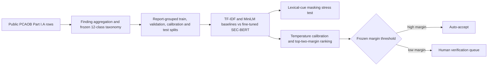

# Selective Audit Routing

Reproducibility package for **Leakage-Controlled Selective Classification of
PCAOB Inspection Findings**.

Public repository:
<https://github.com/HuiyingZHOU15/selective-audit-routing>. Cite a versioned
release rather than the moving `main` branch once the release is archived.

## Current Phase 1--6 adaptation study

The current manuscript evaluates SEC-BERT full fine-tuning, SEC-BERT LoRA,
and general-domain BERT full fine-tuning for an imbalanced 12-class PCAOB
finding task. Reproduction instructions, frozen inputs, official training and
evaluation entry points, and the distinction between the 890-finding
retrospective evaluation and 863-finding post-hoc sensitivity analysis are in
[`reproducibility/README.md`](reproducibility/README.md).

The selective-routing material below is retained as historical project context;
it is not the current paper's principal experimental design or headline result.

> **Rerun status (3 November 2026).** The canonical data-construction script now
> keeps model input target-blind by using the original finding text and records
> unresolved references only as diagnostics. The headline metrics and figures
> below were produced before this correction and must not be treated as final
> until the SEC-BERT, masking, calibration, and routing stages are rerun.

## Paper in one flow



The paper presents a retrospective, leakage-controlled evaluation of selective
automation for organizing PCAOB inspection findings and routing uncertain cases
for human verification. It compares representations, stress-tests lexical-cue
dependence, and evaluates calibration-set thresholds on a retrospective test
with frozen operating policies. It does not claim autonomous audit reasoning, completed human--machine
workflow accuracy, prospective temporal validity, or proven workload reduction.

## Archived pre-correction results

The values below are retained for provenance and are not submit-ready results.
They must be replaced by the complete target-blind rerun described below.

- SEC-BERT retrospective test: accuracy 0.9337; macro-F1 0.9021.
- Masking explicit audit-area cues without retraining: macro-F1 0.2787.
- Matched masked-input SEC-BERT training: macro-F1 0.5332.
- High-coverage policy: coverage 0.9640; selective accuracy 0.9522.
- Conservative policy: coverage 0.9292; selective accuracy 0.9661; disagreement capture 0.5254.

## Repository map

- `manuscript/`: LaTeX manuscript and evidence ledger.
- `src/`: data construction, models, calibration, evaluation and plotting.
- `notebooks/kaggle_sec_bert_calibration_export_v1.ipynb`: canonical GPU training and checkpoint export.
- `results/tables/`: prediction-level and tabular analysis artifacts.
- `results/metrics/`: machine-readable metric summaries.
- `results/reports/`: experiment reports and canonical-result ledgers.
- `tests/`: deterministic data-construction checks.

Legacy exploratory branches are retained for provenance but are excluded from
the manuscript evidence map and from the anonymous reproducibility archive.

## Reproduction level 1: reported results without retraining

Use this path to audit the manuscript from released predictions, logits and
frozen operating points. It does not require a GPU.

1. Create a Python 3.13 environment and install the versions recorded in
   `results/canonical_v3/source_outputs/canonical_environment.json`.
2. Verify `results/canonical_v3/SHA256SUMS.json`, then compare the tables and
   metric JSON files against
   `manuscript/evidence_ledger_v1.csv` and
   `results/reports/sec_bert_canonical_v3_zh.md`.
3. The released prediction-level and calibration outputs are already under
   `results/canonical_v3/`; no private run path is required to audit the paper.
   To rebuild that release from the archived training runs, use:

```powershell
python src/export_canonical_v3_manuscript_artifacts.py `
  --canonical-run PATH_TO_ARCHIVED_CANONICAL_RUN `
  --masking-run PATH_TO_ARCHIVED_MASKING_RUN `
  --output-root results/canonical_v3
```

4. Regenerate the manuscript figures:

```powershell
python src/plot_model_comparison_sensitivity_v1.py
python src/plot_probability_calibration_v1.py
python src/plot_selective_performance_v2.py
python src/plot_dataset_construction_distribution_v1.py
python src/plot_risk_score_comparison_v1.py
python src/plot_class_referral_allocation_v1.py
python src/plot_class_context_error_analysis_v1.py
python src/plot_sec_bert_class_performance_v1.py
python src/plot_ambiguity_signal_diagnostics_v1.py
```

A reproduction should stop and report an error if the headline values or
artifact hashes differ. The legacy `results/metrics/*_v1.json` and
`results/masking_v2/` files document earlier iterations and are not manuscript
evidence; all current manuscript claims use `results/canonical_v3/`.

## Reproduction level 2: rebuild and retrain

### 1. Reacquire and verify the public source

Download the PCAOB Part I.A inspection-findings file from the PCAOB website and
place it at `data/raw/pcaob_part_i_a_2026-09-27.csv`. The frozen snapshot has
SHA-256:

```text
af543784fa73475741e20324ce451b1de1df96fe4a826fd292b1f9aa4b7c96d7
```

The source is Windows-1252 encoded. The scripts write normalized UTF-8
derivatives and never modify the raw snapshot.

```powershell
python src/rebuild_paper_dataset.py `
  --source data/raw/pcaob_part_i_a_2026-09-27.csv
python -m pytest tests -q --import-mode=importlib -p no:cacheprovider
```

### 2. Run the CPU baselines

```powershell
python src/train_baseline.py
python src/train_v2_models.py
```

### 3. Train and export SEC-BERT

Upload the repository dataset to Kaggle, enable a GPU, and run
`notebooks/kaggle_sec_bert_calibration_export_v1.ipynb` from top to bottom. The
notebook must export the best checkpoint, tokenizer, validation history,
calibration/test logits, predictions and manifest before the session ends. Do
not rely on a live Kaggle checkpoint as the only copy.

Run the masking training path with the frozen masking rules, then evaluate the
two exported archives:

```powershell
python src/evaluate_sec_bert_masking_v3.py `
  --canonical-model PATH_TO_ORIGINAL_MODEL `
  --masked-model PATH_TO_MASKED_MODEL `
  --output-root results/masking_v3 `
  --device cuda
```

### 4. Freeze calibration and evaluate once

```powershell
python src/calibrate_and_evaluate_sec_bert_v2.py `
  --run-root PATH_TO_CANONICAL_RUN `
  --bootstrap-replicates 5000 `
  --seed 20261022
```

The archived temperature and thresholds belong to the pre-correction run and
must be re-estimated on the target-blind calibration outputs. Do not retune the
replacement values on the retrospective test or a later temporal snapshot.

## Human verification protocol

For every referred case, re-open the original finding and record the available
report context, whether the text is sufficient, all plausible audit areas, the
final adjudicated class, and the reason for retaining or changing the model
label. Priority strata are cross-model disagreements, multi-topic findings,
unresolved context references, taxonomy-boundary cases, and recurring confusions
involving Cash and Other Assets, Investments and Financial Instruments, or the
broad Reporting/Controls/Estimates/Audit Procedures class. Review a small sample
of high-margin auto-accepted cases as well, because confidence does not prove
label correctness.

## Prospective temporal check

The prospective protocol is frozen but unexecuted. A new PCAOB snapshot is
eligible only if its digest differs and it contains unseen report identities.
Score new reports without retraining, recalibration, threshold changes or
taxonomy revision. If there are no eligible reports, the correct status is
`pending`, not a substituted retrospective estimate.

## Before public release

Remove secrets and private paths, confirm PCAOB redistribution terms, decide
whether model weights may be redistributed, add a software license, publish a
versioned GitHub release, and archive it to obtain a DOI. Update the manuscript
URL and DOI together.

